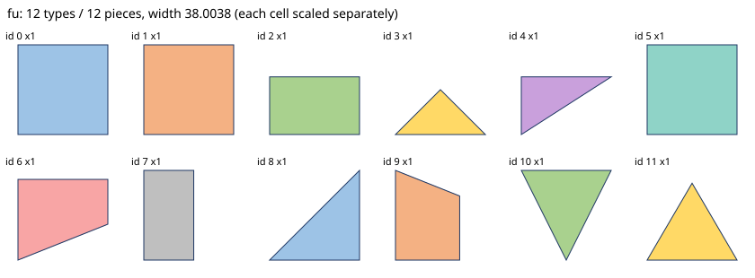
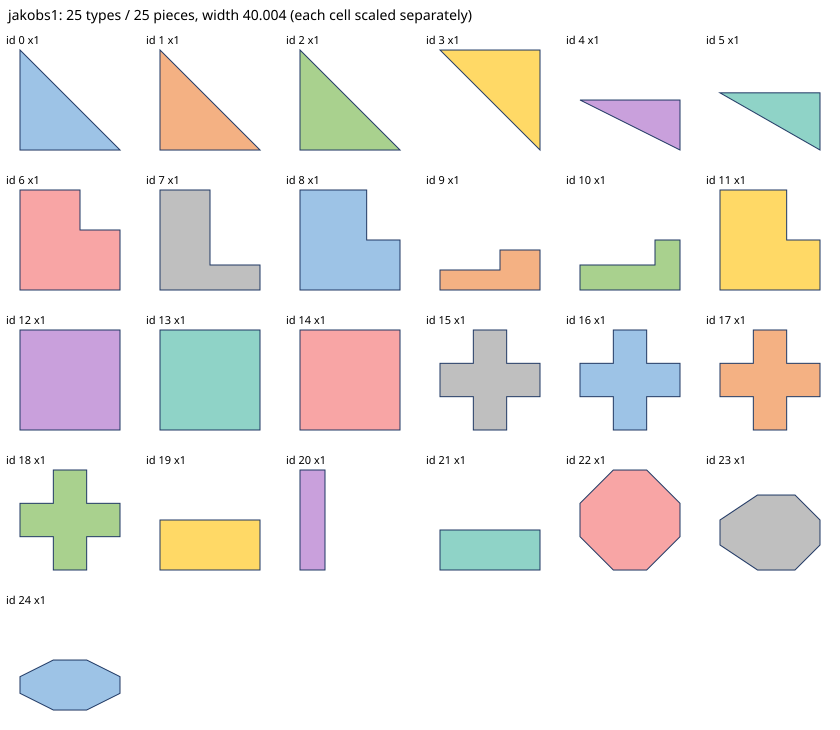
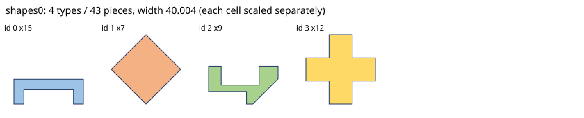
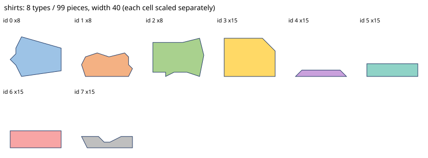
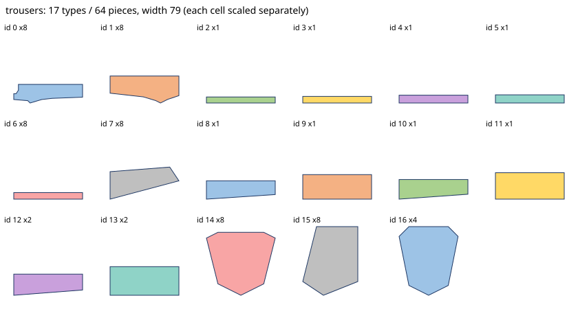
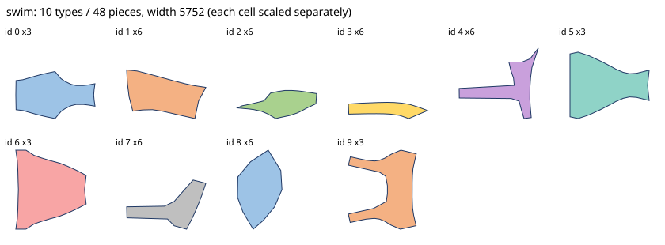
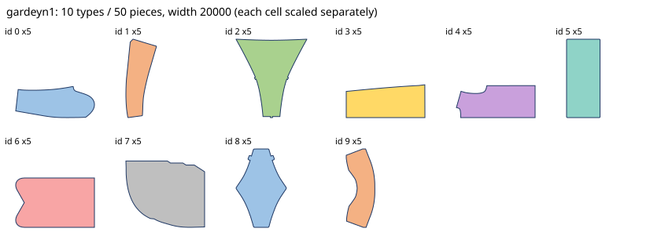
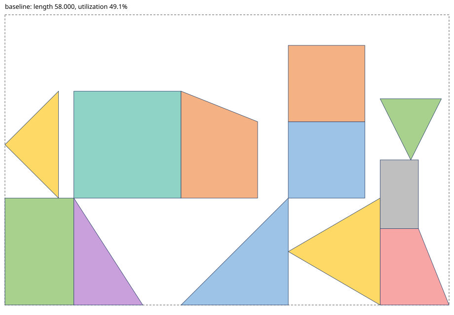

# 실험 인스턴스 7개 모양

각 그림은 부품 종류별로 칸을 나눠 그렸다. **칸마다 크기를 따로 맞췄으므로 부품끼리 실제 크기 비교는 안 된다.**
`x숫자`는 그 부품을 몇 개 배치해야 하는지(수량)다. ESICUP 원본은 y축을 뒤집어 읽어 원본 PDF 그림과 거울상일 수 있다(문제 자체는 동일).

## 1. fu

연구용 문제(Fujita 등, 1993). 사각형·삼각형 등 볼록 부품 12개. 4방향 회전 허용

- 데이터 파일: [`data/instances/sparrow/fu.json`](../data/instances/sparrow/fu.json)
- 원본 출처 폴더(원본 배치 예시 PDF 포함): https://github.com/ESICUP/datasets/tree/main/2d_irregular/fu

## 2. jakobs1

연구용 문제(Jakobs, 1996). 25개 중 10종이 L자 등 오목한 모양

- 데이터 파일: [`data/instances/sparrow/jakobs1.json`](../data/instances/sparrow/jakobs1.json)
- 원본 출처 폴더(원본 배치 예시 PDF 포함): https://github.com/ESICUP/datasets/tree/main/2d_irregular/jakobs

## 3. shapes0

연구용 문제(Oliveira 등, 2000). 4종류 43개, 회전 금지

- 데이터 파일: [`data/instances/sparrow/shapes0.json`](../data/instances/sparrow/shapes0.json)
- 원본 출처 폴더(원본 배치 예시 PDF 포함): https://github.com/ESICUP/datasets/tree/main/2d_irregular/shapes

## 4. shirts

의류 공장 셔츠 패턴. 8종류 99개, 0°/180°만 허용

- 데이터 파일: [`data/instances/sparrow/shirts.json`](../data/instances/sparrow/shirts.json)
- 원본 출처 폴더(원본 배치 예시 PDF 포함): https://github.com/ESICUP/datasets/tree/main/2d_irregular/shirts

## 5. trousers

의류 공장 바지 패턴. 17종류 64개, 길쭉한 부품

- 데이터 파일: [`data/instances/sparrow/trousers.json`](../data/instances/sparrow/trousers.json)
- 원본 출처 폴더(원본 배치 예시 PDF 포함): https://github.com/ESICUP/datasets/tree/main/2d_irregular/trousers

## 6. swim

의류 공장 수영복 패턴. 10종류 48개, 곡선이 많은 복잡한 모양

- 데이터 파일: [`data/instances/sparrow/swim.json`](../data/instances/sparrow/swim.json)
- 원본 출처 폴더(원본 배치 예시 PDF 포함): https://github.com/ESICUP/datasets/tree/main/2d_irregular/swim

## 7. gardeyn1

2025년 논문이 공개한 실제 산업 데이터. 10종류 50개, 꼭짓점 최대 152개

- 데이터 파일: [`data/instances/sparrow/gardeyn1.json`](../data/instances/sparrow/gardeyn1.json)
- 원본 출처 폴더(원본 배치 예시 PDF 포함): https://github.com/ESICUP/datasets/tree/main/2d_irregular/gardeyn

## 참고: 배치 결과는 이렇게 생겼다 (fu, 기준선)

점선 사각형이 사용한 원판이다. 세로가 원판 폭, 가로가 사용 길이다. 알고리즘은 이 가로 길이를 줄이는 것이 목표다.

